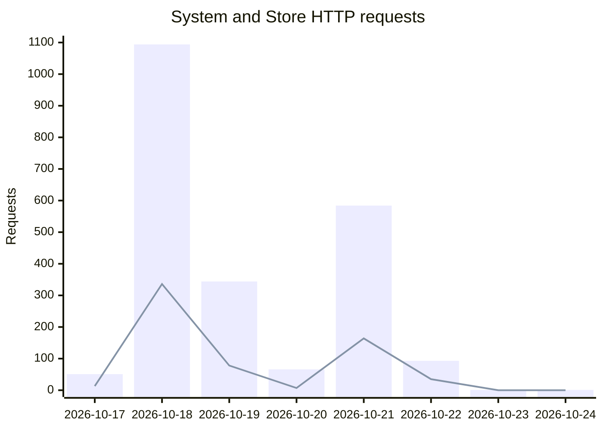

# Application activity

This shows daily System requests and Store Zero activity. System contacts Store to validate the customer's defined job against available materials and registered machine capabilities, and return an updated Q (quoted price). That handoff—from customer definition to a fresh Store answer—is the step being demonstrated. Counts come from Railway's server-side HTTP records, not cookies or visitor tracking. Bots, automated tests, and repeat requests may be included; these are activity counts, not individual people.

**Updated:** 2026-10-24T23:39:47+00:00. Automatic public updates are pending activation. Planned daily refresh: at 12:15 UTC (8:15 a.m. EDT / 7:15 a.m. EST).

## Daily System and Store requests

**Bars: System requests. Line: Store Zero requests.**

| UTC bucket date | System requests | Store requests |
|---|---:|---:|
| 2026-10-17 | 51 | 13 |
| 2026-10-18 | 1,094 | 336 |
| 2026-10-19 | 344 | 78 |
| 2026-10-20 | 66 | 7 |
| 2026-10-21 | 584 | 164 |
| 2026-10-22 | 93 | 35 |
| 2026-10-23 | 1 | 0 |
| 2026-10-24 | 1 | 0 |
| **Window totals** | **2,234** | **633** |

Railway window: 2026-10-17T23:39:46+00:00 through 2026-10-24T23:39:46+00:00. Counts are grouped by the UTC start date of Railway's 10,080-second buckets; calendar-day attribution is approximate, and the first and last days are partial. A zero means the successful native metric query returned no counted requests for that date; it is not a claim about people or complete request-log coverage.

Both destinations receive the same aggregate files from one collection run. Service totals include all HTTP paths; they do not isolate completed evaluations or establish that each Store request came from System.

[Download the counts](activity.csv) · [Inspect the aggregate source](activity.json) · [Program](https://github.com/GeorgePlattDemo/3d-solutions-program)
