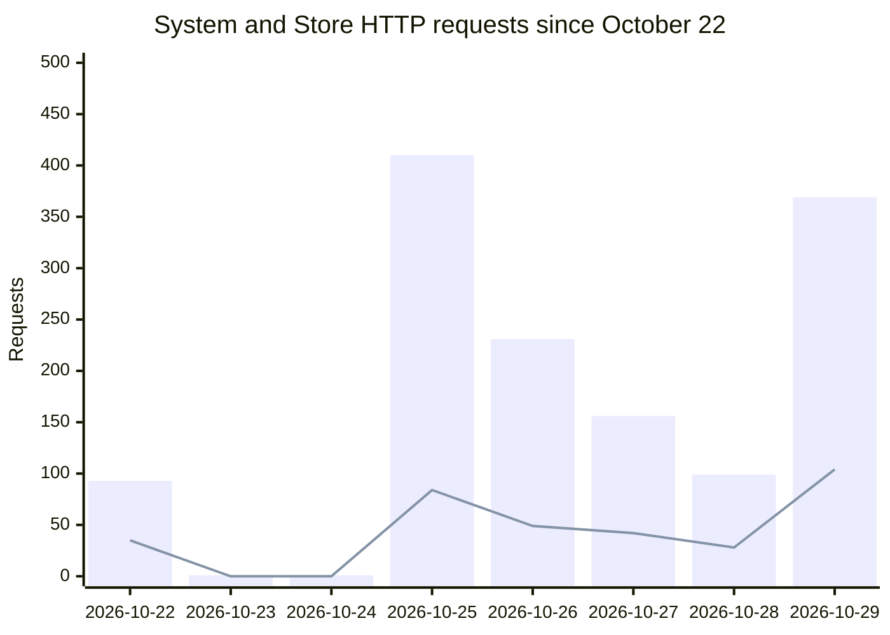

# Application activity

This shows daily System requests and Store Zero activity. System contacts Store to validate the customer's defined job against available materials and registered machine capabilities, and return an updated Q (quoted price). That handoff—from customer definition to a fresh Store answer—is the step being demonstrated. Counts come from Railway's server-side HTTP records, not cookies or visitor tracking. Bots, automated tests, and repeat requests may be included; these are activity counts, not individual people.

**Since October 22, 2026.** This is a cumulative, dated record: older completed days remain when new dates are added.

**Updated:** 2026-10-30T18:00:18+00:00. Last recorded completed UTC bucket date: 2026-10-29. The automatic workflow runs daily at 12:15 UTC.

## Daily System and Store requests

**Bars: System requests. Line: Store Zero requests.**

| UTC bucket date | System requests | Store requests |
|---|---:|---:|
| 2026-10-22 | 93 | 35 |
| 2026-10-23 | 1 | 0 |
| 2026-10-24 | 1 | 0 |
| 2026-10-25 | 410 | 84 |
| 2026-10-26 | 231 | 49 |
| 2026-10-27 | 156 | 42 |
| 2026-10-28 | 99 | 28 |
| 2026-10-29 | 369 | 104 |
| **Cumulative since Oct. 22** | **1,360** | **342** |

The ledger is retained from October 22, 2026, onward. Each newly completed UTC date is appended; earlier dated values are not re-summed, dropped, or rewritten. October 22–29 were recovered from dated GitHub snapshots. Railway's 10,080-second native metric buckets are attributed to their UTC *start date*, so calendar-day assignment is approximate, not a raw event-by-event audit. The current partial day is excluded. A missing collection prevents publication rather than replacing history with zero.

Both destinations receive the same verified aggregate files. These totals include all HTTP paths and do not prove unique people, matched Store evaluations, purchases, or physical jobs.

[Download the cumulative counts](activity.csv) · [Inspect source and history](activity.json) · [Program](https://github.com/GeorgePlattDemo/3d-solutions-program)
